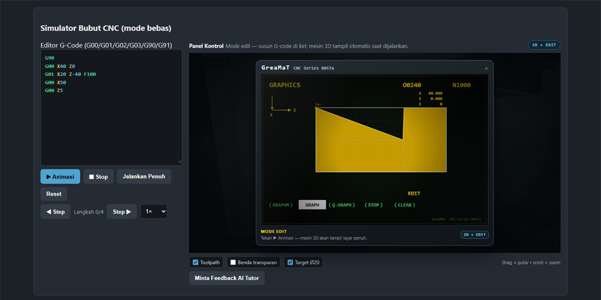
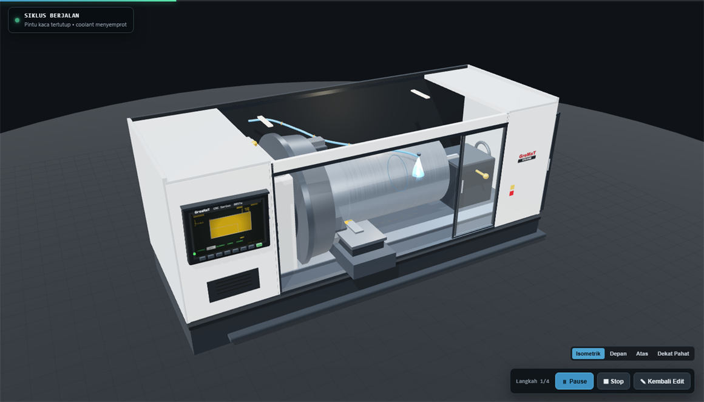

# LMS Simulator Bubut CNC


Learning management system G-Code untuk SMK yang menggabungkan kelas virtual dan
simulator mesin bubut. Guru menerbitkan materi, tugas praktik, dan kuis; siswa
merancang program G-Code, mensimulasikannya secara 2D dan 3D, mengumpulkan
pekerjaan, lalu menerima nilai serta masukan tertulis. Dibuat untuk Logicodix
2026, subtema Smart and Fun Education.



## Daftar isi

- [Kenapa proyek ini](#kenapa-proyek-ini)
- [Fitur per peran](#fitur-per-peran)
- [Simulator](#simulator)
- [Teknologi](#teknologi)
- [Menjalankan secara lokal](#menjalankan-secara-lokal)
- [Akun demo](#akun-demo)
- [Struktur folder](#struktur-folder)
- [Pengujian otomatis](#pengujian-otomatis)
- [API](#api)
- [Penilaian](#penilaian)
- [Deploy ke cPanel](#deploy-ke-cpanel)
- [Dokumentasi lain](#dokumentasi-lain)

## Kenapa proyek ini

Sebagian besar pembelajaran G-Code di SMK berhenti di papan tulis karena
mesin bubut CNC asli mahal dan terbatas. Proyek ini memberi ruang latihan yang
aman: siswa boleh salah, melihat tabrakan pahat secara visual, membaca skor, dan
mengulang tanpa menghabiskan material. Guru tidak hanya melihat hasil akhir,
melainkan riwayat percobaan, G-Code yang dikirim, dan bisa memberi catatan per
pengumpulan.

Tanpa dependensi berat di server. Backend PHP murni (tanpa Composer, tanpa
framework), frontend React yang dibangun sekali lalu dilayani sebagai berkas
statis. Seluruhnya cukup diunggah ke shared hosting cPanel.

## Fitur per peran

### Admin

- Manajemen pengguna: buat manual, impor massal `NIS;Nama;Email`, reset password,
  nonaktifkan, atau hapus akun.
- Mengelola semua rombel, termasuk menentukan guru pengampu.
- Rekap sekolah: pengguna per peran, rombel, tugas terbit, pengumpulan dinilai,
  rata-rata nilai, jumlah simulasi, siswa dan kelas teratas.
- Ekspor nilai ke CSV per rombel maupun sekaligus.

### Guru

- Rombel: buat kelas, kode gabung 6 karakter yang bisa diacak ulang, tambah siswa
  manual lewat pencarian, atau impor massal NIS (email boleh kosong, otomatis
  `nis@sekolah.id`) dengan satu password sementara untuk seluruh batch.
- Materi ajar: PDF, video, tautan, atau teks, berurutan, dengan lampiran sampai
  20 MB.
- Pustaka modul latihan bertingkat, lengkap dengan `starter_gcode` dan LKPD PDF.
- Tugas praktik G-Code (target diameter dan panjang, poin, batas lulus, tenggat,
  boleh mengulang) atau kuis campuran pilihan ganda, benar/salah, isian singkat,
  dan soal praktik yang dinilai simulator.
- Penilaian: daftar pengumpulan termasuk yang belum mengumpulkan, modal G-Code,
  nilai otomatis dari skor simulasi, koreksi massal, minta revisi, rekap kelas,
  dan ekspor CSV.
- Pantau progres tiap siswa dan panggil AI Tutor untuk menjelaskan error.

### Siswa

- Gabung rombel memakai kode gabung, langsung saat mendaftar, atau melalui
  halaman kelas saya.
- Mengerjakan tugas di simulator: editor G-Code dengan sorotan sintaks, panel
  kontrol 2D bergaya GreaMaT, lalu panggung 3D layar penuh saat siklus berjalan.
- Skor otomatis 0 sampai 100 dan deteksi tabrakan (material, chuck, rapid) dengan
  auto-stop di titik masalah.
- Kirim program ke guru, lihat hasil kuis beserta kunci dan pembahasan, serta
  riwayat nilai dengan catatan guru.
- Simulator bebas, menyimpan program ke lemari pribadi, memuatnya kembali, dan
  memperbaruinya.
- Membaca materi ajar rombel dan melihat struktur kelasnya.

## Simulator

Alur dipisah secara sinematik: saat menyusun program yang tampil adalah panel
kontrol 2D, dan begitu animasi dijalankan editor disembunyikan sementara mesin 3D
tampil layar penuh. Tidak ada tombol tukar 2D/3D.

- Mesin bubut 3D: headstock, chuck tiga rahang, bed, tailstock, turret, pahat,
  selubung, dan pintu kaca geser yang menutup otomatis selama siklus namun tetap
  transparan.
- Coolant menyemprot benda kerja selama siklus berjalan dan berhenti saat pause,
  stop, atau alarm.
- Percikan geram di titik potong untuk G01/G02/G03, toolpath hijau dan oranye,
  indikator target diameter serta posisi Z, empat preset kamera.
- HUD skor hanya muncul setelah siklus selesai atau alarm.
- Fallback otomatis ke 2D bila WebGL gagal; Three.js dimuat sebagai chunk terpisah
  sehingga pengguna mode 2D tidak mengunduh berkas 3D.




## Teknologi

| Bagian | Teknologi | Lokasi |
|---|---|---|
| Frontend | React 18, Vite 5, Canvas 2D, Three.js | `lms-cnc-client/` |
| Mesin G-Code | JavaScript di browser untuk visual, PHP untuk penilaian, kedua aturan identik | `lms-cnc-client/src/api.js` dan `backend-php/lib/GCode.php` |
| Backend | PHP 8 tanpa framework, JWT HS256, bcrypt, PDO MySQL | `backend-php/` |
| Database | MySQL/MariaDB, skema di `backend-php/database.sql` | 11 tabel |
| Auth | Token bearer, peran divalidasi ulang ke database tiap request | `backend-php/lib/Lms.php` |
| UI | Design system sendiri, primitif di `src/ui/`, ikon stroke SVG tanpa emoji | `lms-cnc-client/src/ui/` |

## Menjalankan secara lokal

Prasyarat: PHP 8.1 atau lebih baru, MySQL/MariaDB, Node.js 18 atau lebih baru.

```bash
# 1. Basis data (membuat dan memakai database cnc_lms)
mysql -uroot < backend-php/database.sql

# 2. Konfigurasi backend
cp backend-php/.env.example backend-php/.env
# isi DB_NAME, DB_USER, DB_PASS sesuai server lokal

# 3. API
cd backend-php && php -S 127.0.0.1:8000 api.php

# 4. Frontend (folder lain)
cd lms-cnc-client && npm install && npm run dev
```

Buka http://localhost:5173. Proxy Vite meneruskan `/api` dan `/uploads` ke
`DEV_API_URL` (bawaan `http://127.0.0.1:8000`). Nilai environment lebih
didahulukan daripada isi `.env`, berguna saat berpindah antara XAMPP dan hosting.

Simulator 3D juga bisa dicoba tanpa login melalui http://localhost:5173/?demo=3d.

## Akun demo

| Peran | Email | Password |
|---|---|---|
| Admin | `admin@smk.sch.id` | `password123` |
| Guru | `guru@smk.sch.id` | `password123` |
| Siswa | `andi@murid.sch.id` | `password123` |
| Siswa | `sinta@murid.sch.id` | `password123` |

## Struktur folder

```
backend-php/          API PHP (front controller, routes, lib, SQL, tests)
lms-cnc-client/       Frontend React + Vite (src: pages, components, three, ui)
cPanel/               isi siap upload ke public_html + zip + sql/ (tidak masuk git)
deploy/               build-cpanel.sh, berkas migrasi SQL, panduan deploy
docs/                 kontrak API, tangkapan layar, foto referensi panel asli
README.md             berkas ini
```

Detail tiap folder ada di [deploy/README.md](deploy/README.md) dan
[docs/API-LMS.md](docs/API-LMS.md).

## Pengujian otomatis

```bash
php backend-php/tests/test-engine.php                        # mencetak skor dan detail engine PHP pada program contoh
API_BASE=http://127.0.0.1:8000 node backend-php/tests/test-api.js
API_BASE=http://127.0.0.1:8000 node backend-php/tests/test-lms.js
```

`test-api.js` menjalankan alur lama (login, modul, percobaan, program, progres,
AI Tutor). `test-lms.js` menguji alur LMS dari sisi admin, guru, dan siswa:
rombel dan impor siswa, materi, tugas praktik, kuis empat tipe, pengumpulan,
penilaian, revisi, rekap, statistik, ekspor CSV, dan proteksi peran.

## API

Semua endpoint berprefix `/api` dan memakai header `Authorization: Bearer <token>`.
Kontrak lengkap, bentuk objek, dan aturan peran ada di
[docs/API-LMS.md](docs/API-LMS.md).

| Kelompok | Endpoint |
|---|---|
| Auth | `POST /api/login` `POST /api/register` `GET/PUT /api/me` `PUT /api/me/password` |
| Pengguna | `GET/POST /api/users` `POST /api/users/bulk` `PUT/DELETE /api/users/{id}` `POST /api/users/{id}/reset-password` |
| Rombel | `GET/POST /api/kelas` `GET/PUT/DELETE /api/kelas/{id}` `PUT /api/kelas/{id}/kode` `POST /api/kelas/gabung` `GET/POST /api/kelas/{id}/anggota` `POST /api/kelas/{id}/import` `GET /api/kelas/{id}/rekap` `GET /api/export/nilai` |
| Materi | `GET/POST /api/materi` `PUT/DELETE /api/materi/{id}` |
| Pustaka modul | `GET/POST /api/modules` `GET/PUT/DELETE /api/module/{id}` |
| Tugas | `GET/POST /api/tugas` `GET /api/tugas/saya` `GET/PUT/DELETE /api/tugas/{id}` `PUT /api/tugas/{id}/status` |
| Pengerjaan | `POST /api/tugas/{id}/submit` `POST /api/tugas/{id}/kuis` `GET /api/tugas/{id}/hasil` `GET /api/tugas/{id}/pengumpulan` |
| Penilaian | `PUT /api/pengumpulan/{id}` `POST /api/pengumpulan/{id}/koreksi` `GET /api/nilai/saya` |
| Lainnya | `POST/GET /api/attempts` `GET/POST/PUT/DELETE /api/programs` `GET /api/progress` `POST /api/ai-tutor` |
| Statistik | `GET /api/stats/siswa` `/api/stats/guru` `/api/stats/kelas/{id}` `/api/stats/sekolah` |

## Penilaian

Skor simulator selalu 0 sampai 100 dan dihitung oleh mesin G-Code PHP: dimulai
dari 100, tiap error dipotong 25 dan tiap peringatan dipotong 5; bila program
bersih tetapi profil hasil pengeboran meleset dari target, selisihnya (mm)
dikalikan 8. Nilai guru memakai skala poin tugas agar angka yang diketik guru
benar-benar angka yang ia berikan. Nilai akhir dinormalkan ke skala 100 dengan
`COALESCE(nilai_guru * 100 / poin, skor_simulasi)`, sehingga pekerjaan yang belum
diperiksa tetap memiliki skor otomatis.

Kuis dinilai otomatis: pilihan ganda berdasarkan indeks kunci, benar/salah
berdasarkan boolean, isian singkat dengan pencocokan teks yang mengabaikan huruf
besar dan spasi berlebih, dan soal praktik mengambil skor simulasi. Siswa melihat
kunci beserta pembahasan setelah mengumpulkan.

## Deploy ke cPanel

```bash
bash deploy/build-cpanel.sh      # menghasilkan cPanel/ dan cPanel/cPanel-upload.zip
```

Unggah isi `cPanel/` ke `public_html`, jalankan berkas migrasi SQL berurutan,
lalu isi domain pada `cPanel/api/.env`. Panduan lengkap, termasuk pengaturan PHP,
batas upload, izin folder, dan pemeriksaan hasil ada di [deploy/README.md](deploy/README.md).

## Dokumentasi lain

- [docs/API-LMS.md](docs/API-LMS.md) kontrak API dan bentuk objek.
- [deploy/README.md](deploy/README.md) panduan deploy cPanel dan alur produksi.
- [docs/referensi-panel-cnc.jpeg](docs/referensi-panel-cnc.jpeg) foto panel kontrol
  mesin asli yang menjadi acuan tata letak simulator.
