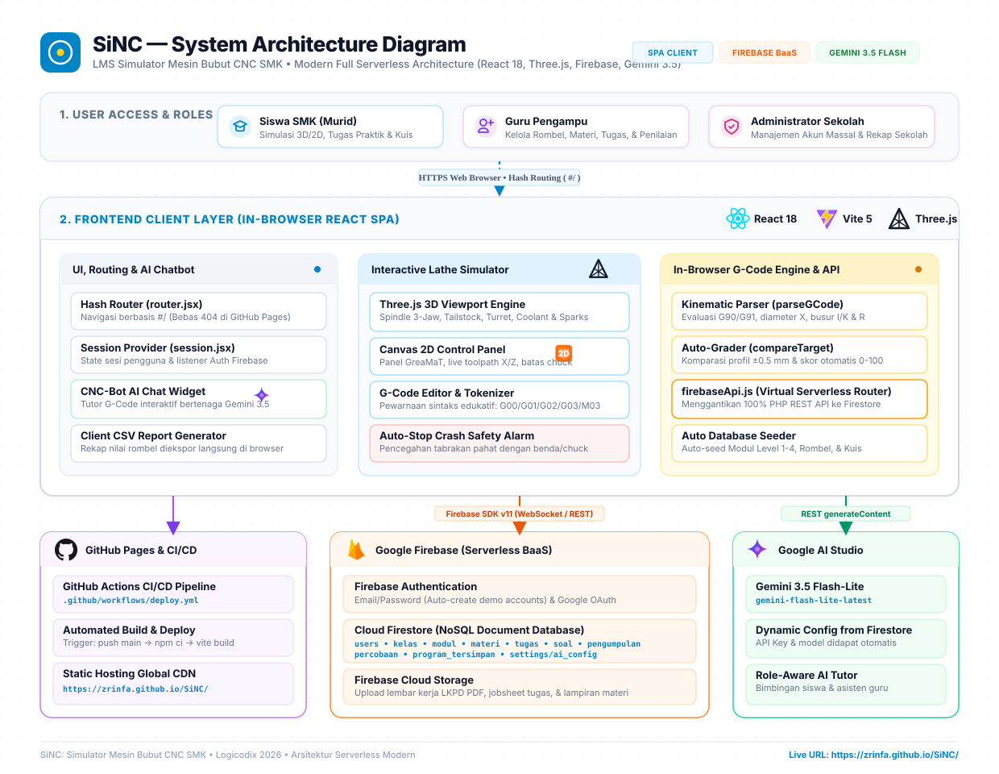
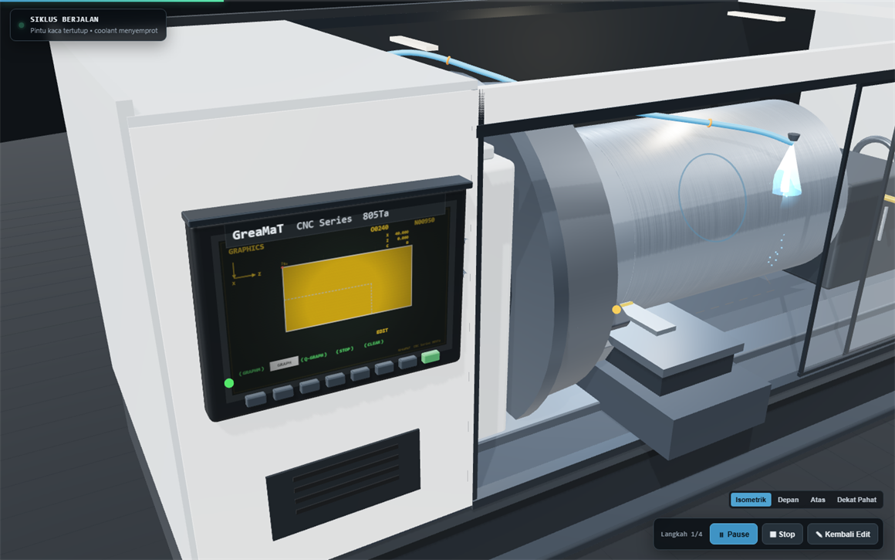

# SiNC — LMS Simulator Bubut CNC (Serverless Edition)


Learning Management System (LMS) G-Code untuk SMK berbasis **Full Serverless** yang menggabungkan kelas virtual, simulator mesin bubut CNC 3D interaktif, dan asisten cerdas **Google Gemini AI**. 

🌐 **Demo Live Web:** [https://zrinfa.github.io/SiNC/](https://zrinfa.github.io/SiNC/)


---

## 🏛️ Arsitektur Serverless Modern

Aplikasi ini telah dimigrasikan dari arsitektur monolitik (PHP + MySQL + cPanel) menjadi **Full Serverless Single Page Application (SPA)** yang modern, ringan, scalable, dan bebas biaya server.



```
[ Pengguna / Browser ]
        │
        ├── 1. Frontend & Visualisasi
        │      ├── React 18 + Vite (SPA)
        │      ├── Three.js (Mesin Bubut CNC 3D Real-time)
        │      ├── Canvas 2D (Panel Kontrol GreaMaT & Toolpath)
        │      └── Client-side G-Code Simulation Engine
        │
        ├── 2. Hosting & CI/CD
        │      └── GitHub Pages via GitHub Actions (.github/workflows/deploy.yml)
        │
        ├── 3. Cloud Database & Backend
        │      ├── Firebase Authentication (Email/Password & Google Sign-In)
        │      ├── Cloud Firestore (Dokumen Pengguna, Rombel, Materi, Tugas, Percobaan)
        │      └── Firebase Storage (Upload PDF LKPD & File Lampiran Materi)
        │
        └── 4. AI & Pembelajaran Cerdas
               └── Google Gemini 3.5 Flash-Lite (Tutor Pintar CNC-Bot)
```

### Keunggulan Arsitektur Baru:
1. **Zero Server Maintenance:** Tidak memerlukan server PHP, Apache/Nginx, maupun database MySQL yang harus dikelola manual.
2. **Auto CI/CD Deployment:** Setiap `git push origin main` akan otomatis dikompilasi oleh GitHub Actions dan langsung ter-deploy ke GitHub Pages.
3. **Client-Side Simulation Parity:** Mesin verifikasi G-Code, deteksi tabrakan (rapid collision, chuck hit, negative diameter), dan penilaian toleransi benda kerja berjalan 100% di browser siswa tanpa latensi jaringan.
4. **AI Asisten Real-time:** Didukung oleh **Gemini 3.5 Flash-Lite** dengan konfigurasi tersimpan aman di Firestore (`settings/ai_config`), siap memberikan bimbingan interaktif kepada siswa maupun asisten bagi guru.

---

## ⚙️ Fitur Utama Berdasarkan Peran

### 1. Siswa
* **Simulator 3D Mesin Bubut Real-time:** Spindle berputar, chuck 3 rahang, pergerakan pahat (toolpath X & Z), coolant aktif, percikan geram, dan pintu kaca pelindung otomatis.
* **Auto-Stop & Collision Alarm:** Otomatis berhenti dan menampilkan peringatan visual jika terjadi tabrakan material (G00 menabrak benda) atau pahat mengenai chuck.
* **Tugas Praktik & Kuis Otomatis:** Menulis program G-Code berdasarkan jobsheet/LKPD dan langsung dinilai oleh mesin simulasi. Kuis interaktif (PG, Benar/Salah, Isian, Praktik).
* **AI CNC-Bot Tutor:** Asisten chat cerdas yang siap menjawab pertanyaan siswa seputar kode G-Code, rumus pemakanan, dan rekomendasi perbaikan kode.
* **Lemari Program Pribadi:** Menyimpan, mengedit, dan memuat ulang kode G-Code buatan sendiri.

### 2. Guru
* **Manajemen Rombel / Kelas:** Membuat rombel dengan kode unik (mis. `TPM1A1`), mengundang siswa, atau mengimpor siswa massal via NIS.
* **Penyusun Tugas (Task Builder):** Merancang jobsheet pembubutan bertingkat, tirus, radius (G02/G03), mengunggah LKPD PDF ke Cloud Storage.
* **Penilaian Fleksibel:** Melihat riwayat kode G-Code siswa, replay simulasi, memberikan catatan/revisi, dan mengekspor rekap nilai kelas langsung ke file CSV.
* **Pustaka Modul Bertingkat:** 4 level modul latihan bertingkat bawaan dengan target profil dan starter code siap pakai.

### 3. Administrator
* Mengelola seluruh data pengguna (guru & siswa), reset kata sandi, serta rekap statistik keseluruhan sekolah.

---

## 📸 Tampilan Simulator 3D




---

## 🛠️ Stack Teknologi

| Komponen | Teknologi | Keterangan |
|---|---|---|
| **Frontend Framework** | React 18, Vite 5 | SPA responsif dan ultra-cepat |
| **3D Engine & Grafis** | Three.js (r186) & Canvas 2D | Visualisasi mesin bubut fisik dan lintasan sayat |
| **Routing** | Hash Router (`#/halaman`) | Kompatibel penuh dengan GitHub Pages tanpa rewrite server |
| **Authentication** | Firebase Auth | Mendukung Email/Password dan Google Sign-In |
| **Database** | Cloud Firestore | NoSQL document database untuk data LMS |
| **File Storage** | Firebase Storage | Penyimpanan berkas PDF materi & LKPD |
| **Artificial Intelligence** | Google Gemini 3.5 Flash-Lite | Chatbot tutor dan evaluasi kode cerdas |
| **Deployment / CI-CD** | GitHub Actions & Pages | Build dan deploy otomatis |

---

## 🚀 Menjalankan Secara Lokal (Development)

Prasyarat: **Node.js (v18+)** dan **npm**.

```bash
# 1. Masuk ke direktori client
cd lms-cnc-client

# 2. Pasang dependensi
npm install

# 3. Jalankan server pengembangan
npm run dev
```

Buka `http://localhost:5173` di browser Anda.

> Simulator 3D juga dapat langsung dicoba tanpa login melalui:  
> `http://localhost:5173/?demo=3d`

---

## 🔑 Akun Demo (One-Click Login)

Di halaman login telah disediakan tombol instan untuk akun demo (otomatis terdaftar ke Firebase Auth):

| Peran | Email | Kata Sandi |
|---|---|---|
| **Administrator** | `admin@smk.sch.id` | `password123` |
| **Guru Pengampu** | `guru@smk.sch.id` | `password123` |
| **Siswa 1 (Andi)** | `andi@murid.sch.id` | `password123` |
| **Siswa 2 (Sinta)** | `sinta@murid.sch.id` | `password123` |

---

## 📁 Struktur Repositori

```
├── .github/
│   └── workflows/
│       └── deploy.yml          # GitHub Actions workflow untuk GitHub Pages
├── docs/                       # Foto referensi panel dan tangkapan layar simulator
├── firestore.rules             # Aturan keamanan database Cloud Firestore
├── storage.rules               # Aturan keamanan berkas Firebase Storage
├── lms-cnc-client/             # Kode sumber aplikasi utama (React + Vite)
│   ├── src/
│   │   ├── components/         # Komponen Simulator (3D, 2D, CNC-Bot, Control Panel)
│   │   ├── pages/              # Halaman Siswa, Guru, Admin, dan Login
│   │   ├── three/              # Model 3D mesin bubut, chuck, pahat, partikel coolant
│   │   ├── ui/                 # Design system primitif dan ikon SVG
│   │   ├── api.js              # G-Code Simulation Engine & Dispatcher
│   │   ├── firebase.js         # Inisialisasi Firebase SDK
│   │   ├── firebaseApi.js      # Serverless API Adapter & Gemini AI Integration
│   │   ├── router.jsx          # Hash-based SPA Router
│   │   └── session.jsx         # State autentikasi dan profil pengguna
│   ├── package.json
│   └── vite.config.js
└── README.md
```

---

## 📄 Lisensi & Hak Cipta

Dibuat untuk ajang **Logicodix 2026** — *Subtema: Smart and Fun Education*.  
Hak cipta dilindungi undang-undang.
